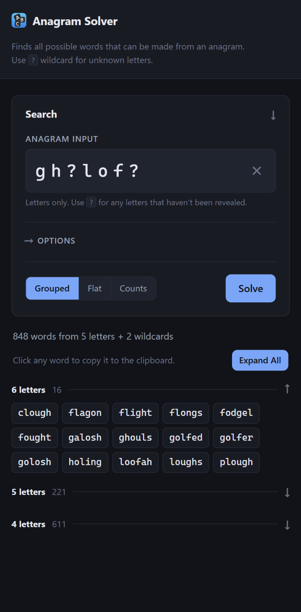

<div align="center">
  
  <div style="margin-bottom:7px">
    <div style="font-weight:600;font-size:35px;">
      Anagram Solver
    </div>
    <div style="font-weight:500;font-style:italic;font-size:17px;">
      Developed by Dragz
    </div>
    <div style="font-weight:500;font-size:22px;margin-top:10px">
      Find every word your letters can spell!
    </div>
  </div>

  
  
  

  <br>

  <p style="margin-top:10px;">
    
    
  </p>
</div>

---

### Architecture

Runs as a local web page or from the command line, powered by a Python backend.
The web-page option starts a local server that hosts the interface on your computer and will work offline; with the same word-finding functionality available in either interface.

Letter combinations are checked against the [Enhanced North American Benchmark LExicon (ENABLE)](https://norvig.com/ngrams/enable1.txt) dictionary to find all possible words.

---

### Quick start

```bash
python main.py run          # web page at http://127.0.0.1:8000
python main.py "he?lpf"     # same thing, in the terminal
```

`?` is a wildcard — a letter you have not identified yet. 

To update the bundled dictionary, run:

```bash
python main.py update
```

This downloads the complete ENABLE1 list; internet is needed only for the update,
not for solving. All word lengths are saved, and min/max options control the results.
Restart a running local server to reload it; run `python build_standalone.py` to
refresh the standalone page. For a local dictionary file, use
`python main.py update --src enable1.txt`.

---

### Web page

```bash
python server.py            # or: python main.py run
```

Opens `http://127.0.0.1:8000` and solves as you type. 
Binds to localhost only, standard library only, nothing downloaded at runtime. 
`--port` moves it, `--no-browser` prevents the opening of a tab.


Clicking a word copies it to the clipboard, and each length group collapses —
**Collapse All** beside the hint folds or unfolds every group at once. The ×
inside the input clears it.

#### While it runs

| Key | |
| :-- | :-- |
| <kbd>Ctrl</kbd>+<kbd>R</kbd> | Restart — reloads `ui.py`, `main.py` and the word list |
| <kbd>Ctrl</kbd>+<kbd>O</kbd> | The same, and reopen the page in a browser |
| <kbd>Ctrl</kbd>+<kbd>C</kbd> | Stop |

---

<div style="font-size:20px;font-weight:600;margin-bottom:10px">
  <span>Mobile & Web Deployments </span>
  <span style="font-size:16px;font-weight:500;font-style:italic;">(no Python or server host)</span>
</div>


`index.html` is the whole solver in one file — dictionary, code, styles and icon all inlined — so it needs no server, no install and no network once loaded.

```bash
python build_standalone.py
```
 
rebuilds it from the very same page the server serves — `web/index.html`,`style.css` and `app.js` — with the stylesheet, the icon, the word list and `web/solver.js` inlined into it (about 782 KB with the full dictionary).

There is no second template, so the two cannot drift apart. **Edit `web/` and `ui.py`, never the
generated `index.html`** — it carries a banner saying as much, and the next
build overwrites anything typed into it.

You should not have to run that build by hand. Two git hooks in `.githooks/`
keep it honest: `pre-commit` rebuilds `index.html` and stages it into the same
commit whenever a source changes, and `pre-push` refuses a push when what is in
`HEAD` does not match its sources. They install with one command per clone:

```bash
git config core.hooksPath .githooks
```

`server.py` also warns at startup, and after every restart, when `index.html` is
older than anything it is built from.

For a phone, GitHub Pages is easiest: **Settings → Pages**, source `main`, root
folder. It is then live at `https://dragzda69.github.io/anagram_solver/`, which
`python main.py open` opens for you. Safari's **Share → Add to Home Screen**
gives it an icon that opens fullscreen.

> `web/solver.js` is a direct port of the Python solver, and only the standalone
> loads it: the served page posts to `/api/solve` and gets the Python one. That
> single call is the only difference between the two builds.

---

### Command Line

#### Commands

| Command | |
| :-- | :-- |
| `python main.py <anagram>` | Solve — the default, so `solve` is optional |
| `python main.py solve <anagram>` | The same thing, said out loud |
| `python main.py run` | Start the local server and open the page |
| `python main.py open` | Open the hosted page in a browser |
| `python main.py update` | Download and save the complete ENABLE1 dictionary |

A command has to come first, and only the first word is read as one — so a rack
that happens to spell one is still reachable as `python main.py solve open`.

#### Options


| Option | What it does |
| :-- | :-- |
| `-l, --length 4,5,7` | Only these word lengths |
| `-m, --min N` | Minimum length (default 4) |
| `-M, --max N` | Maximum length (default: number of tiles) |
| `-e, --exact` | Only words using every letter — the "big word" |
| `-p, --pattern` | Positional filter, e.g. `..t..n` for `_ _ t _ _ n` |
| `-x, --exclude` | Drop words containing any of these letters, e.g. `qxz` |
| `-n, --limit N` | Show at most N words per length group |
| `-c, --count` | Counts only, no words |
| `--flat` | One word per line, no headers — for piping |

Case does not matter anywhere: `-x QXZ` and `-x qxz` are the same, as are the
board letters. On the web page, `--pattern` sits in its own collapsed section
under Options, since it is the one you reach for least.

`python main.py -h` shows a banner, the commands and these options; each command
has a page of its own too (`solve -h`, `run -h`, `open -h`, `update -h`). The web page exposes
the solve options, with the view switcher covering `--flat` and `--count`.

---

### Word List

`wordlist.txt` is the complete **ENABLE1** list, public domain, with no word-length
trimming. It is the only list the solver reads — no online lookups while solving.
Run `python main.py update` to refresh it; a failed update leaves the existing
file unchanged. [DICTIONARY.md](DICTIONARY.md) covers why this list was chosen.

---

### Files

| File | |
| :-- | :-- |
| `main.py` | The solver, and the CLI |
| `server.py` | Local web server for the desktop page |
| `ui.py` | Every label, message and UI timing both pages use |
| `cli/` | Styled help pages and the shared update spinner |
| `web/` | The page itself: `index.html`, `style.css`, `app.js`, plus `solver.js` for the offline build |
| `index.html` | Standalone single-file solver — no server, works offline |
| `icon.png` | The app icon; `web/icon-small.png` is the embedded copy |
| `wordlist.txt` | Complete ENABLE1 dictionary, all word lengths |
| `build_wordlist.py` | Regenerates `wordlist.txt` |
| `build_standalone.py` | Regenerates `index.html` |
| `.githooks/` | Rebuilds the standalone on commit, verifies it on push |
| `DICTIONARY.md` | Why ENABLE1, and how it was verified |
