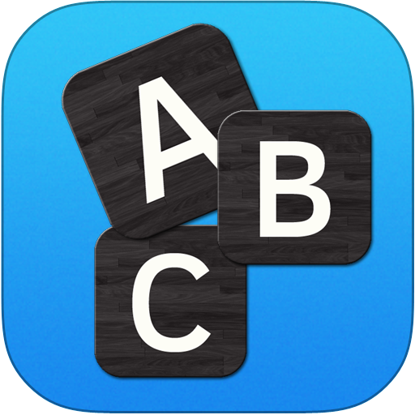
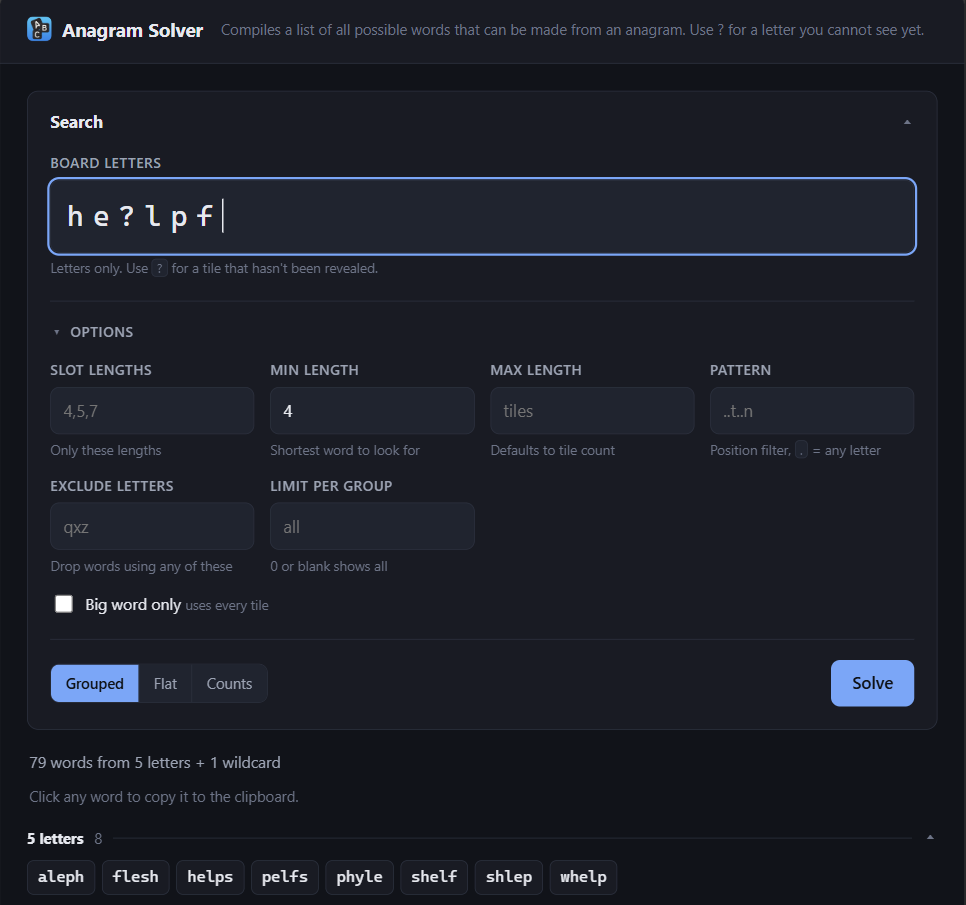
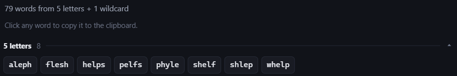
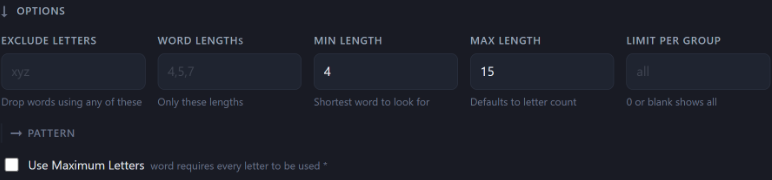

<div align="center">



# Anagram Solver

**Every word your letters can spell, grouped longest-first.**

Runs as a local web page or from the command line — off the same solver.


<span style="padding-top:10px;display:flex;justify-content:center">



</div>

---

## Quick start

```bash
python main.py run          # web page at http://127.0.0.1:8000
python main.py "he?lpf"     # same thing, in the terminal
```

`?` is a wildcard — a tile you have not identified yet. Quote the letters: in
bash an unquoted `?` is a shell glob.

---

## Web page

```bash
python server.py            # or: python main.py run
```

Opens `http://127.0.0.1:8000` and solves as you type. Binds to localhost only,
standard library only, nothing downloaded at runtime. `--port` moves it,
`--no-browser` stops it opening a tab.



Clicking a word copies it to the clipboard. Each length group collapses.

#### While it runs

| Key | |
| :-- | :-- |
| <kbd>Ctrl</kbd>+<kbd>R</kbd> | Restart — reloads `ui.py`, `main.py` and the word list |
| <kbd>Ctrl</kbd>+<kbd>O</kbd> | The same, and reopen the page in a browser |
| <kbd>Ctrl</kbd>+<kbd>C</kbd> | Stop |

They need a real console and are Windows-only (`msvcrt`); elsewhere,
<kbd>Ctrl</kbd>+<kbd>C</kbd> still works.

---

## On a phone, or anywhere without Python

`index.html` is the whole solver in one file — dictionary, code, styles and icon
all inlined — so it needs no server, no install and no network once loaded.

```bash
python build_standalone.py
```

rebuilds it from the very same page the server serves — `web/index.html`,
`style.css` and `app.js` — with the stylesheet, the icon, the word list and
`web/solver.js` inlined into it (665 KB, ~25 ms to start). There is no second
template, so the two cannot drift apart. Edit `web/`, never the generated
`index.html`.

For a phone, GitHub Pages is easiest: **Settings → Pages**, source `main`, root
folder. It is then live at `https://dragzda69.github.io/anagram_solver/`, which
`python main.py open` opens for you. Safari's **Share → Add to Home Screen**
gives it an icon that opens fullscreen.

> `web/solver.js` is a direct port of the Python solver, and only the standalone
> loads it: the served page posts to `/api/solve` and gets the Python one. That
> single call is the only difference between the two builds.

---

## Command Line

#### Commands

| Command | |
| :-- | :-- |
| `python main.py <letters>` | Solve — the default, so `solve` is optional |
| `python main.py solve <letters>` | The same thing, said out loud |
| `python main.py run` | Start the local server and open the page |
| `python main.py open` | Open the hosted page in a browser |

A command has to come first, and only the first word is read as one — so a rack
that happens to spell one is still reachable as `python main.py solve open`.

#### Options



| Option | What it does |
| :-- | :-- |
| `-l, --length 4,5,7` | Only these word lengths |
| `-m, --min N` | Minimum length (default 4) |
| `-M, --max N` | Maximum length (default: number of tiles) |
| `-e, --exact` | Only words using every tile — the "big word" |
| `-p, --pattern` | Positional filter, e.g. `..t..n` for `_ _ t _ _ n` |
| `-x, --exclude` | Drop words containing any of these letters, e.g. `qxz` |
| `-n, --limit N` | Show at most N words per length group |
| `-c, --count` | Counts only, no words |
| `--flat` | One word per line, no headers — for piping |

Case does not matter anywhere: `-x QXZ` and `-x qxz` are the same, as are the
board letters.

`python main.py -h` shows a banner, the commands and these options; each command
has a page of its own too (`solve -h`, `run -h`, `open -h`). The web page exposes
all of them, with the view switcher covering `--flat` and `--count`.

---


## Word List

`wordlist.txt` is **ENABLE1**, public domain, trimmed to 4–12 letters (151,337
words). It is the only list the solver reads — nothing to pick or download at
runtime. [DICTIONARY.md](DICTIONARY.md) covers why, and the one caveat about
rebuilding with `python build_wordlist.py`.

---


## Files

| File | |
| :-- | :-- |
| `main.py` | The solver, and the CLI |
| `server.py` | Local web server for the desktop page |
| `ui.py` | Every label, message and UI timing both pages use |
| `cli/` | The styled help pages — banner, command headers, option tables |
| `web/` | The page itself: `index.html`, `style.css`, `app.js`, plus `solver.js` for the offline build |
| `index.html` | Standalone single-file solver — no server, works offline |
| `icon.png` | The app icon; `web/icon-small.png` is the embedded copy |
| `wordlist.txt` | ENABLE1, 4–12 letters |
| `build_wordlist.py` | Regenerates `wordlist.txt` |
| `build_standalone.py` | Regenerates `index.html` |
| `DICTIONARY.md` | Why ENABLE1, and how it was verified |
